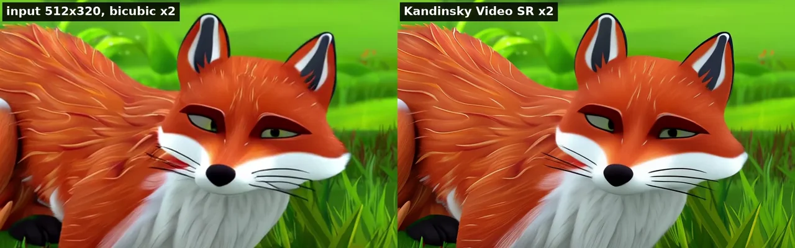
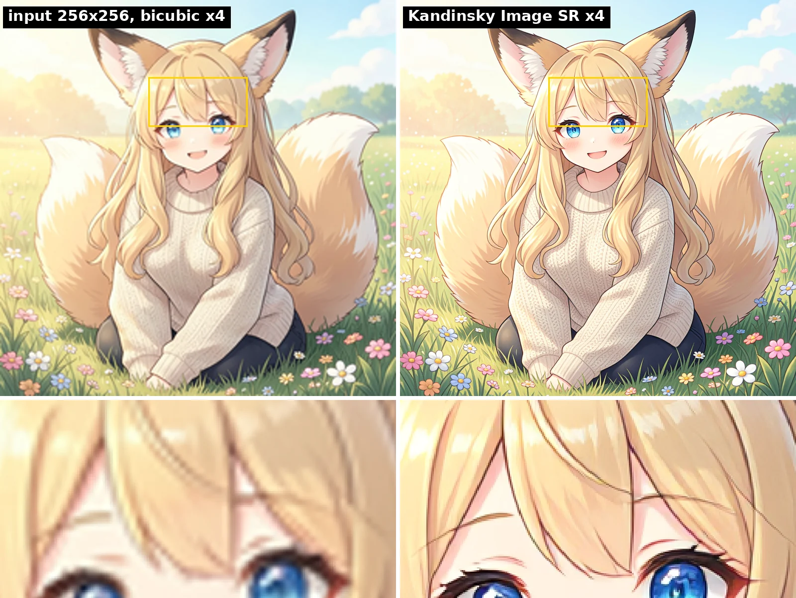
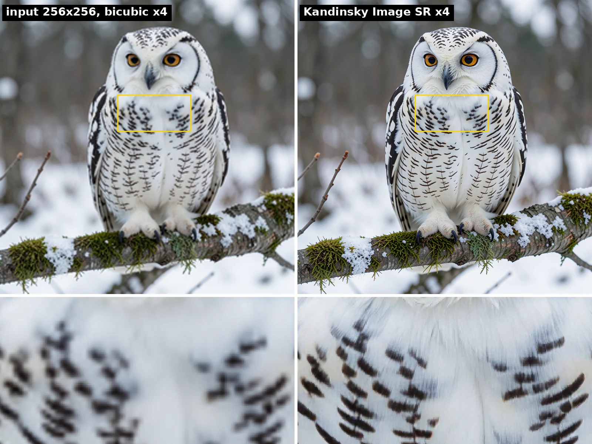

# ComfyUI-KandinskySR

Kandinsky 6.0 Video Super-Resolution 2.0 and Kandinsky ImageSR 2.0 by [kandinskylab](https://huggingface.co/kandinskylab),
natively in ComfyUI. Upscale a video x2, x2.25 or x4, or images x2 or x4. The models run as ComfyUI models on
ComfyUI's own memory management, with no vendored runtime and no extra Python packages.

- **Video:** Kandinsky 6.0 VSR 2.0, a 2-step pi-Flow distilled diffusion transformer with NABLA sparse attention,
  the KVAE 3D video VAE and latent upscalers. Clips are cut into overlapping tiles, upscaled and blended back.
- **Image:** Kandinsky ImageSR 2.0, a one-step transformer on the FLUX.1 VAE, tiled the same way.

<!-- inline player: the mp4 uploaded through GitHub goes here -->


<sub>A 512x320 clip (Wan2.1 VACE 1.3B, generated for this demo) upscaled x2 with Kandinsky Video SR at its defaults;
left: the input enlarged with bicubic. Full quality: [fox_compare.mp4](assets/fox_compare.mp4).</sub>




## Install

- **ComfyUI Manager:** search for "Kandinsky SR".
- **Comfy CLI:** `comfy node install kandinsky-sr-native`
- **git:**

  ```bash
  cd ComfyUI/custom_nodes
  git clone https://github.com/PedroMarinhoDev/ComfyUI-KandinskySR
  ```

No extra Python packages are needed; restart ComfyUI afterwards.

## Model files

From [PedroMarinhoDev/Kandinsky-SR-ComfyUI](https://huggingface.co/PedroMarinhoDev/Kandinsky-SR-ComfyUI). The repository
mirrors ComfyUI's `models` folder, so this puts every file in place:

```bash
cd ComfyUI/models
hf download PedroMarinhoDev/Kandinsky-SR-ComfyUI --local-dir . --include "*.safetensors"
```

| File | Size | Folder | Needed for |
|---|---|---|---|
| [kandinsky6_vsr_2.0_distilled2steps_bf16](https://huggingface.co/PedroMarinhoDev/Kandinsky-SR-ComfyUI/blob/main/diffusion_models/kandinsky-sr/kandinsky6_vsr_2.0_distilled2steps_bf16.safetensors) | 3.19 GB | `diffusion_models/kandinsky-sr/` | video (one of the two) |
| [kandinsky6_vsr_2.0_distilled2steps_int8_convrot](https://huggingface.co/PedroMarinhoDev/Kandinsky-SR-ComfyUI/blob/main/diffusion_models/kandinsky-sr/kandinsky6_vsr_2.0_distilled2steps_int8_convrot.safetensors) | 1.96 GB | `diffusion_models/kandinsky-sr/` | video (one of the two) |
| [kandinsky_kvae_3d_2.0_t4s16_bf16](https://huggingface.co/PedroMarinhoDev/Kandinsky-SR-ComfyUI/blob/main/vae/kandinsky-sr/kandinsky_kvae_3d_2.0_t4s16_bf16.safetensors) | 3.48 GB | `vae/kandinsky-sr/` | video |
| [kandinsky6_sr_latent_upscaler_x2_bf16](https://huggingface.co/PedroMarinhoDev/Kandinsky-SR-ComfyUI/blob/main/latent_upscale_models/kandinsky-sr/kandinsky6_sr_latent_upscaler_x2_bf16.safetensors) | 1.53 GB | `latent_upscale_models/kandinsky-sr/` | video x2 and x2.25 |
| [kandinsky6_sr_latent_upscaler_x4_bf16](https://huggingface.co/PedroMarinhoDev/Kandinsky-SR-ComfyUI/blob/main/latent_upscale_models/kandinsky-sr/kandinsky6_sr_latent_upscaler_x4_bf16.safetensors) | 2.89 GB | `latent_upscale_models/kandinsky-sr/` | video x4 |
| [kandinsky_image_sr_2.0_bf16](https://huggingface.co/PedroMarinhoDev/Kandinsky-SR-ComfyUI/blob/main/diffusion_models/kandinsky-sr/kandinsky_image_sr_2.0_bf16.safetensors) | 9.06 GB | `diffusion_models/kandinsky-sr/` | images (one of the two) |
| [kandinsky_image_sr_2.0_int8_convrot](https://huggingface.co/PedroMarinhoDev/Kandinsky-SR-ComfyUI/blob/main/diffusion_models/kandinsky-sr/kandinsky_image_sr_2.0_int8_convrot.safetensors) | 5.14 GB | `diffusion_models/kandinsky-sr/` | images (one of the two) |
| [ae](https://huggingface.co/black-forest-labs/FLUX.1-schnell/blob/main/ae.safetensors) (FLUX.1 VAE) | 0.34 GB | `vae/` | images |

The files are the released weights repackaged into single safetensors files with their settings in the metadata,
plus int8 ConvRot variants of the two transformers. The converters are in [`tools/`](tools/).

## Nodes and inputs

Four nodes under **Kandinsky SR**.

**Load Kandinsky Video SR Models**: the transformer (`bf16` or `int8_convrot`), the KVAE and the two latent
upscalers. `second_gpu` (advanced) gives a second card its own copy of the transformer and the KVAE; each card then
takes the next tile when it is free.

**Kandinsky Video SR Upscale**: a video (or images) in, a video file out, with the source's audio and frame rate.

| Input | Default | What it does |
|---|---|---|
| `scale` | 2x | 2x, 2.25x (a 1.125x pre-upscale, then 2x) or 4x |
| `seed` | 42 | start noise; the same seed gives the same frames on any card |
| `kernels` | fast | `fast`: custom attention, norm and decode kernels (CUDA with Triton). `exact`: the reference's arithmetic |
| `stitch` | pixels | `pixels`: decode every tile and blend the frames, as the reference does. `latent`: blend the tiles' latents and decode each frame once: faster, a little sharper where tiles overlap |
| `window_frames` | 361 | the longest stretch the model sees at once; longer clips run in overlapping windows (see [Long clips](#long-clips)). Lower it to use less VRAM |
| `overlap` | 0.2 | least overlap between neighbouring tiles |
| `encoder` | auto | NVENC HEVC / H.264 or x264 for the output file |
| `fps` | 24 | frame rate of an `images` input |

Sources faster than 24 fps are thinned to 24 fps, as in the reference: the model was trained at that rate.

**Load Kandinsky Image SR Model**: the image transformer (`bf16` or `int8_convrot`). The VAE is the stock FLUX.1 VAE
from ComfyUI's own **Load VAE** node.

**Kandinsky Image SR Upscale**: `scale` 2x or 4x, `creativity` 0-8 (how much detail the model invents; 4 is the
release default), `kernels` fast or exact, `tile_batch_size` (advanced).

## Examples

[`example_workflows/`](example_workflows/) has one workflow for video and one for images; they also show up in
ComfyUI's template browser. Point their Load Video / Load Image nodes at your own files.



<sub>The demo images were generated for this README with FLUX.2 Klein 4B, downscaled to 256x256 with lanczos as the
low-quality input and upscaled x4 with Kandinsky Image SR at its defaults. Bottom rows: the yellow box, enlarged.</sub>

## Speed

Measured through the nodes on a warm ComfyUI server, input to finished file, on an RTX 4090 and an RTX 3090
(ComfyUI 0.44). "Reference" is kandinskylab's own code on the same card.

**Video, 15 s (361 frames):**

| Output | Cards | Settings | Time | Peak VRAM |
|---|---|---|---|---|
| 960x540 → 1920x1080 | 4090 | defaults | 4.8 min | 13.3 GB |
| 960x540 → 1920x1080 | 4090 | int8 + `stitch` latent | 3.9 min | 10.5 GB |
| 960x540 → 1920x1080 | 4090 + 3090 | defaults | 4.0 min | 13.3 GB |
| 1920x1080 → 3840x2160 | 4090 + 3090 | `stitch` latent | 15.7 min | 17.3 GB |

**Video, 5 s (121 frames, 768x512 → 1536x1024), RTX 4090:**

| | Time |
|---|---|
| Reference (its uncompiled decoder) | 241 s |
| `exact` | 189 s |
| `fast` (default) | 95 s |
| `fast` + `stitch` latent | 71 s |

`exact` stays as close to the reference's frames as the reference is to itself between its compiled and uncompiled
runs (54.5 dB); `fast` is 53.5 dB from the reference. The fast decode works in float16 where the reference uses
bfloat16, and is the closer of the two to a float32 decode.

**Images, RTX 4090, int8 file with `fast`:**

| | Reference | This pack | Peak VRAM |
|---|---|---|---|
| 1024x1024 x2 | 6.6 s | 3.4 s | 7.0 GB |
| 1024x1024 x4 | 18.3 s | 9.2 s | 7.2 GB |
| 640x424 x4 | 4.4 s | 2.3 s | 7.0 GB |

The bf16 file takes about 40% longer and 12 GB. The fast kernels need an NVIDIA card (RTX 30 series or newer)
with Triton; without them the nodes run the plain paths, which are much slower for video.

## Long clips

There is no length limit. A clip longer than `window_frames` (361 frames, 15 s at 24 fps) runs as overlapping
windows: each goes through the whole pipeline, neighbours share 9 frames, and those are cross-faded. Frames are read
and written a window at a time, so memory does not grow with the clip. Where two windows meet, detail softens
slightly for about a third of a second, because the two windows render the shared frames a little differently.

Smaller windows (for example 121) use much less VRAM and are faster per frame, with more joins.

## Differences from the reference

- The start noise is drawn on the CPU, so a seed gives the same result on every card (the reference draws it on the
  GPU, where it depends on the card model).
- The reference darkens a few pixels in each corner of every frame (a clamp in its tile blend); this pack does not.
- A clip that is not 1 + 8k frames long is padded instead of cut, so no input frame is dropped.
- Clips longer than 15 s, the `latent` stitch, a second card and the int8 files are additions.

## License and credits

The nodes are licensed under the GNU General Public License v3.0 ([LICENSE](LICENSE)), like ComfyUI, whose code they
import. The model code follows kandinskylab's releases, under the MIT License ([LICENSE-MIT](LICENSE-MIT)); see
[NOTICE](NOTICE) for which files are adapted from where.

- Kandinsky 6.0 VSR: [kandinskylab/kandinsky-video-sr](https://github.com/kandinskylab/kandinsky-video-sr),
  [weights](https://huggingface.co/kandinskylab/Kandinsky-6.0-VSR-2.0-distilled2steps-Diffusers) (MIT)
- Kandinsky ImageSR: [kandinskylab/kandinsky-image-sr](https://github.com/kandinskylab/kandinsky-image-sr),
  [weights](https://huggingface.co/kandinskylab/Kandinsky-ImageSR-2.0) (MIT)
- FLUX.1 VAE: [black-forest-labs/FLUX.1-schnell](https://huggingface.co/black-forest-labs/FLUX.1-schnell) (Apache-2.0)

This project is not affiliated with kandinskylab.
